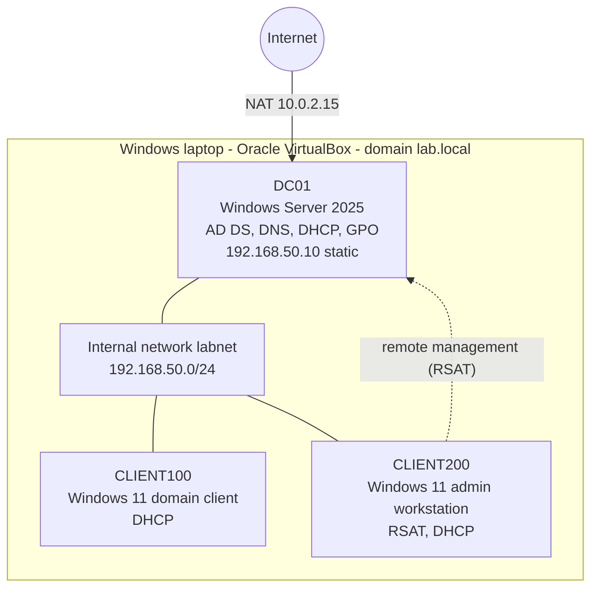

# Windows Server Home Lab: Active Directory, DHCP, Group Policy and Helpdesk Practice

A virtual Windows domain (`lab.local`) built on Oracle VirtualBox to practise the work of an IT support technician: user and computer management, access control, Group Policy, remote administration and documented troubleshooting.

**Author:** Mbali Masombuka | **Target role:** Junior IT Support / Helpdesk Technician | **Background:** BIT and postgraduate diploma in cybersecurity (Nelson Mandela University)

> All machines are virtual, use Microsoft evaluation licences and run on an isolated network. No real company data, credentials or addresses appear in this repository.

---

## Lab architecture

A standalone image is also available: [docs/lab-network-diagram.svg](docs/lab-network-diagram.svg).

| Machine | Role | OS | IP address method |
|---|---|---|---|
| DC01 | Domain controller for `lab.local` (AD DS, DNS, DHCP, Group Policy, file share) | Windows Server 2025 Standard (evaluation) | Static `192.168.50.10` on labnet; second adapter on NAT (`10.0.2.15`) for updates |
| CLIENT100 | Standard domain-joined user workstation | Windows 11 Enterprise (evaluation) | DHCP from DC01 (`192.168.50.100` to `192.168.50.200`) |
| CLIENT200 | Lab admin workstation with RSAT (Server Manager, AD, GPO, DNS and DHCP tools) | Windows 11 Enterprise (evaluation) | DHCP from DC01 (`192.168.50.100` to `192.168.50.200`) |

---

## What this lab demonstrates

| Skill area | What I did | Evidence |
|---|---|---|
| Virtualisation | Built and configured VMs in Oracle VirtualBox with NAT and internal networking | [Design](docs/01-lab-design-and-ip-plan.md), [build notes](docs/02-build-notes.md) |
| Active Directory | Created the `lab.local` domain, OUs, users and security groups | [AD structure](docs/03-active-directory-structure.md) |
| DHCP and DNS | Configured a DHCP scope and AD-integrated DNS for domain clients | [Build notes](docs/02-build-notes.md) |
| Group Policy | Applied a Computer Configuration policy to lock idle screens | [GPO write-up](docs/04-group-policy-lock-screen.md) |
| File shares and permissions | Shared a folder and controlled access with NTFS permissions and security groups | [Shares write-up](docs/05-file-shares-and-permissions.md) |
| Remote administration | Managed the server from a separate admin workstation using RSAT | [Build notes](docs/02-build-notes.md) |
| Troubleshooting and documentation | Logged real setup problems with symptoms, steps, cause and fix | [Incidents](incidents/) and [knowledge base](kb/) |
| Process and security habits | Wrote a password reset runbook with identity verification and a joiner/leaver checklist | [Runbooks](runbooks/) |
| Scripting (draft) | PowerShell password reset helper with `-WhatIf`, logging and no password storage | [Script](scripts/) |

## Repository map

| Folder | Contents |
|---|---|
| `docs/` | Lab design, IP plan, build notes, AD structure, Group Policy and file share write-ups, diagram, screenshots guide |
| `incidents/` | Incident records from problems I hit while building the lab |
| `kb/` | Short knowledge base articles: symptom, cause, steps, verify, escalate |
| `runbooks/` | Step-by-step procedures a helpdesk team would follow |
| `scripts/` | PowerShell helper scripts |
| `practice-tickets/` | Helpdesk scenarios I am working through, with status |

## Status

| Item | Status |
|---|---|
| Domain controller, DHCP, DNS | Done |
| CLIENT100 joined to the domain | Done |
| Lock screen Group Policy | Done |
| `Sales` shared folder with NTFS permissions | Done |
| CLIENT200 as RSAT admin workstation | In progress |
| Practice ticket scenarios | In progress (see [practice-tickets](practice-tickets/scenarios.md)) |
| Password reset script | Draft, testing in lab |
| Routing/NAT through DC01 so clients reach the internet | Planned |
| Print server and a Linux client | Planned |

## Lessons learned

- Document while you work: a clear ticket note saves more time than the fix itself.
- Snapshot before every risky change. It turns a disaster into a two-minute restore.
- Most "network" problems are one of four things: the cable or adapter, DHCP, DNS or a firewall rule. Work through them in order.
- A domain depends on DNS. Pointing a client at the wrong DNS server breaks domain join and sign-in.
- Give permissions to groups, not people, and remember users must sign out and in after a group change.

## Tools and technologies

Oracle VirtualBox, Windows Server 2025, Windows 11, Active Directory Domain Services, DHCP, DNS, Group Policy, NTFS/SMB, RSAT, Command Prompt, PowerShell, Event Viewer.
