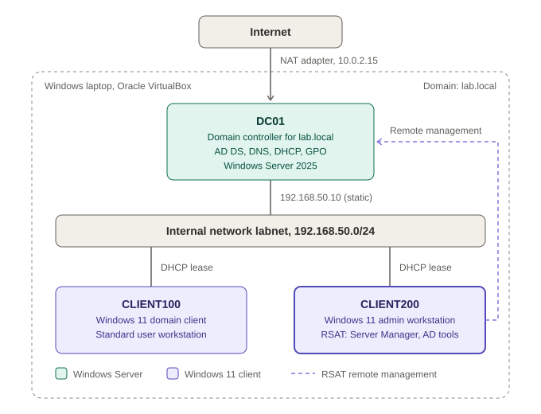

# 01. Lab Design and IP Plan

## Goal
Build a small, safe copy of a company network so I can practise the daily work of IT support: accounts, access, policies, remote administration and troubleshooting. The lab must run on one 16 GB laptop and must never touch my home or work network.

## Host
| Item | Value |
|---|---|
| Host | Windows laptop, 16 GB RAM |
| Hypervisor | Oracle VM VirtualBox 7.x |
| Licences | Microsoft evaluation editions (lab use only) |

## Virtual machines
| VM | RAM / CPU / disk | Network adapters |
|---|---|---|
| DC01 | 4 GB / 2 / 60 GB | Adapter 1: NAT (internet for updates). Adapter 2: Internal Network `labnet` |
| CLIENT100 | 4 GB / 2 / 60 GB | Adapter 1: Internal Network `labnet` |
| CLIENT200 | 4 GB / 2 / 60 GB | Adapter 1: Internal Network `labnet` |

Only two or three VMs run at once so the host keeps enough memory. DC01 always starts first.

## Network plan
| Item | Value |
|---|---|
| Domain | `lab.local` |
| Internal network name | `labnet` |
| Subnet | `192.168.50.0/24` (mask `255.255.255.0`) |
| DC01 address | `192.168.50.10` (static) |
| DHCP scope | `192.168.50.100` to `192.168.50.200` |
| DNS server for all clients | `192.168.50.10` (DC01) |
| Default gateway | None on labnet (isolated by design) |
| DC01 NAT adapter | `10.0.2.15` (given by VirtualBox) |

## Design decisions and why
- **Internal network instead of bridged:** my DHCP server cannot interfere with a real router, and the lab is safe to break.
- **DC01 acts as DNS and DHCP:** domain sign-in and domain join depend on clients finding the domain controller through DNS.
- **Desktop Experience edition of Windows Server:** the graphical tools (Server Manager, AD Users and Computers) are needed for learning. Server Core is command-line only.
- **Separate admin workstation (CLIENT200):** admins manage servers remotely with RSAT instead of working directly on the server, which is how most companies operate.
- **Snapshots at every milestone:** each major stage (server ready, domain joined, policies done) has a snapshot so I can practise breaking and fixing things.

## Diagram

