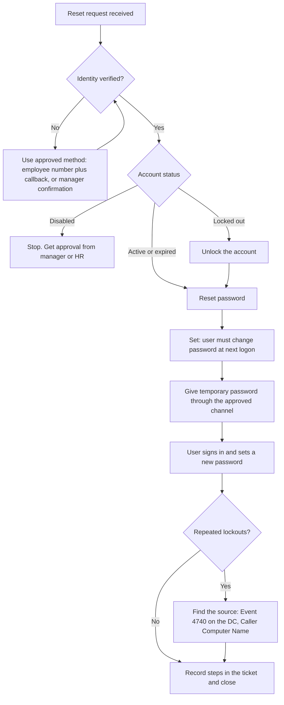

# Runbook: User Password Reset

**Purpose:** Reset a user's domain password safely, without exposing the account to social engineering.
**Audience:** Helpdesk technicians (L1)

## Rules
1. **Verify identity before anything else.** A password reset is one of the most common ways attackers abuse a helpdesk.
2. **Never ask for the user's current or old password.**
3. **Never write the temporary password in the ticket, chat or email.**
4. Use the approved secure channel to hand over the temporary password.
5. Log every reset in the ticket.

## Flow


## Steps
1. **Verify identity.** Use the approved method (for example employee number plus a call back to the number held in HR records).
2. **Check account status** in AD Users and Computers or:
   ```powershell
   Get-ADUser jsmith -Properties LockedOut,Enabled,PasswordExpired,LastLogonDate
   ```
3. **If the account is disabled,** stop. Do not enable it without written approval from the manager or HR.
4. **Unlock** if needed: `Unlock-ADAccount -Identity jsmith`
5. **Reset** the password in AD (right-click user, Reset Password) and tick **User must change password at next logon**. Or use the helper script in [scripts](../scripts/).
6. **Hand over** the temporary password through the approved channel.
7. **Confirm** the user signed in and changed it.
8. **If the account keeps locking,** check Event ID **4740** on the domain controller. The *Caller Computer Name* field shows where the bad password is coming from (an old saved password on a phone, mapped drive or service).
9. **Document** in the ticket: who asked, how identity was verified, what was done, and the outcome. Never include the password.

## Escalate when
- Identity cannot be verified.
- The account is disabled and approval is unclear.
- Several accounts are locking at the same time (possible attack).
